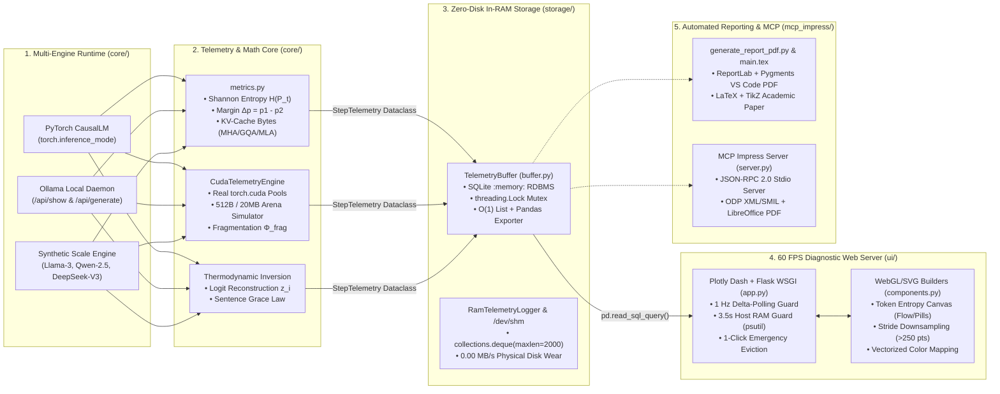
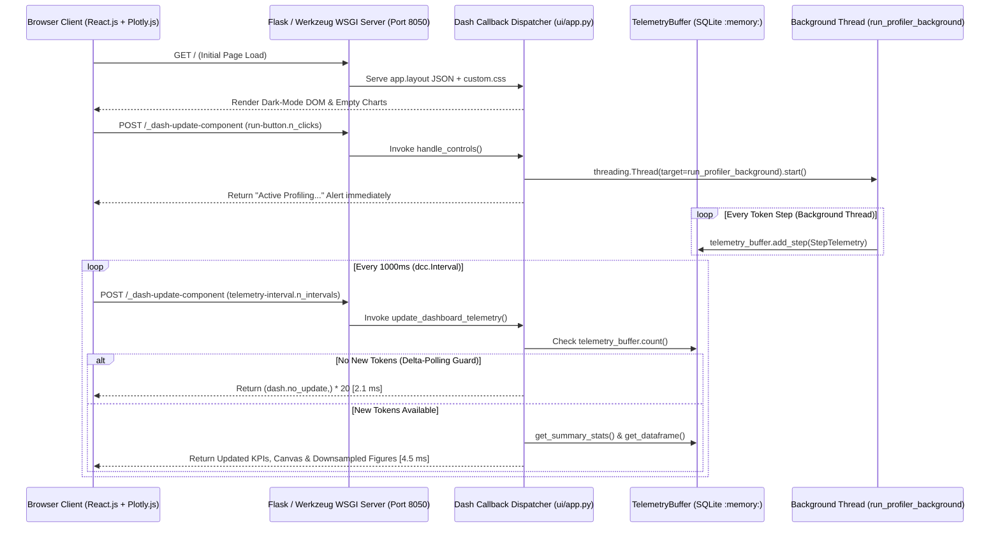

# 🐍 Ultimate Master Guide: Python, Data Analysis & Visualization (DAV), Chart Syntax & Web Dashboards
### *A Systematic Deep-Dive into the Real-Time Transformer Inference Profiler & KV-Cache / VRAM Inspector (`@[Project]`)*

> [!IMPORTANT]
> **What This Master Guide Covers:**
> 1. **Part 1 — Complete Project Architecture & Codebase Deep-Dive**: End-to-end analysis of [`Project`](file:///home/arindam/DAVP/Project), its 4-layer zero-disk telemetry pipeline, mathematical derivations, and module-by-module dissection.
> 2. **Part 2 — Core & Advanced Python Engineering Concepts**: Type systems, `@dataclass`, lazy generators (`yield`), thread synchronization (`threading.Lock`), circular RAM buffers (`collections.deque`), OS memory telemetry (`psutil`), archive synthesis (`zipfile`), and `pytest` mocking.
> 3. **Part 3 — Key Python DAV (Data Analysis & Visualization) Modules**: In-depth reference for **NumPy**, **Pandas**, **SQLite3 & Analytical SQL**, **PyTorch Tensor Analytics**, **SciPy**, and **Scikit-Learn** (including strict ML best practices).
> 4. **Part 4 — Complete Chart Syntax Encyclopedia**: Copy-pasteable syntax, parameters, and visual anatomy for **9 core chart families** across **Plotly Graph Objects (`go`)**, **Plotly Express (`px`)**, **Matplotlib (`plt`)**, and **Seaborn (`sns`)**.
> 5. **Part 5 — Webserver & Dashboard Frameworks**: Deep architectural guide to **Plotly Dash**, **Flask & Werkzeug WSGI**, **Streamlit**, **HTTP NDJSON Streaming (`requests`)**, and **Model Context Protocol (MCP) JSON-RPC 2.0 Servers**.

---

## 🏛️ Part 1: Systematic Analysis of `@[Project]`

### 1.1 High-Level Purpose & Problem Statement
The project—[**Real-Time Transformer Inference Profiler & KV-Cache / VRAM Inspector**](file:///home/arindam/DAVP/Project/README.md)—solves three critical observability problems in autoregressive Large Language Model (LLM) serving:
1. **The GPU Memory Wall**: Prompt evaluation (**Pre-fill**) is *compute-bound* (parallel matrix-matrix multiplication, `GEMM`), whereas sequential token generation (**Autoregressive Decoding**) is strictly *memory-bandwidth bound* (matrix-vector multiplication, `GEMV`), dominated by the linear $O(S)$ growth of **Key-Value (KV) Cache** tensors in VRAM/RAM.
2. **Allocator Fragmentation & OOM Hazards**: Frameworks like PyTorch reserve large contiguous memory arenas (e.g., 2 MB / 20 MB slabs) and round tensor allocations to 512-byte blocks, creating a gap between *allocated* memory ($M_{\text{allocated}}$) and *reserved* memory ($M_{\text{reserved}}$). Additionally, loading oversized local models (e.g., 30B/32B GGUF models on a 16 GB laptop) causes catastrophic swap thrashing unless guarded by pre-flight RAM locks.
3. **Black-Box Uncertainty & Disk Wear**: Standard inference engines hide token-level predictive uncertainty (**Shannon Entropy** $H(P_t)$ and **Top-1/Top-2 Margin** $\Delta p_t$) while writing disk logs that degrade SSDs and distort **Inter-Token Latency (ITL)**.

### 1.2 End-to-End System Architecture Diagram



### 1.3 Live Application Visual Walkthrough

````carousel

<!-- slide -->

<!-- slide -->

<!-- slide -->

<!-- slide -->

<!-- slide -->

<!-- slide -->

````

---

### 1.4 Complete Mathematical & Theoretical Framework Used in `@[Project]`

Every formula below is implemented directly in [`core/metrics.py`](file:///home/arindam/DAVP/Project/core/metrics.py), [`core/profiler.py`](file:///home/arindam/DAVP/Project/core/profiler.py), and [`ui/components.py`](file:///home/arindam/DAVP/Project/ui/components.py):

| Concept | Mathematical Formula | Code Implementation & Meaning |
| :--- | :--- | :--- |
| **1. Softmax with Temperature ($\tau$)** | $$p_{t,i}(\tau) = \frac{\exp\left(\frac{z_{t,i} - \max_k z_{t,k}}{\tau}\right)}{\sum_{j=1}^{\|V\|} \exp\left(\frac{z_{t,j} - \max_k z_{t,k}}{\tau}\right)}$$ | Implemented in [`core/profiler.py`](file:///home/arindam/DAVP/Project/core/profiler.py#L286-L293) & [`ui/components.py`](file:///home/arindam/DAVP/Project/ui/components.py#L875-L877). Subtracting $\max_k z_{t,k}$ prevents floating-point `exp()` overflow. As $\tau \to 0^+$, decoding becomes greedy ($\arg\max$); as $\tau \to \infty$, $P_t$ approaches a uniform distribution. |
| **2. Shannon Entropy ($H$)** | $$H(P_t) = -\sum_{i=1}^{\|V\|} p_{t,i} \log_2(p_{t,i}) \quad \text{[bits]}$$ | Implemented in [`shannon_entropy()`](file:///home/arindam/DAVP/Project/core/metrics.py#L14-L45). Clamps probabilities to $\epsilon = 10^{-12}$ to prevent $\log_2(0) = -\infty$. Measures predictive uncertainty in bits (shannons). |
| **3. Normalized Entropy ($H_{\text{norm}}$)** | $$H_{\text{norm}}(P_t) = \frac{H(P_t)}{\log_2(\|V\|)} \in [0, 1]$$ | Implemented in [`normalized_entropy()`](file:///home/arindam/DAVP/Project/core/metrics.py#L47-L64). Divides raw entropy by the theoretical maximum $\log_2(\|V\|)$, making uncertainty comparable across models with different vocabulary sizes (e.g., GPT-2 $\|V\|=50,257$ vs. Llama-3 $\|V\|=128,256$). |
| **4. Probability & Logit Margins** | $$\Delta p_t = p_{t,(1)} - p_{t,(2)}, \quad \Delta z_t = z_{t,(1)} - z_{t,(2)}$$ | Implemented in [`compute_top_k_candidates()`](file:///home/arindam/DAVP/Project/core/metrics.py#L107-L115). When $\Delta p_t < 0.20$ (the crimson **Ambiguity Threshold** in [`build_confidence_margin_chart()`](file:///home/arindam/DAVP/Project/ui/components.py#L677-L685)), the top two tokens are nearly tied, signaling branching/hallucination risk. |
| **5. Thermodynamic Logit Inversion** | $$z_i = z_1 + \tau_{\text{eff}} \ln\left(\frac{p_i}{p_1}\right), \quad z_1 = 10 + 8p_1$$ | Implemented in [`core/profiler.py`](file:///home/arindam/DAVP/Project/core/profiler.py#L553-L558). Reconstructs unnormalized logits from streaming probabilities when an API doesn't expose raw logits, enabling post-hoc temperature sensitivity simulation across $\tau \in [0.1, 2.0]$. |
| **6. MHA / GQA / MQA KV-Cache Bytes** | $$\mathcal{M}_{\text{KV}} = 2 \cdot B \cdot S \cdot L \cdot N_{\text{kv}} \cdot d_{\text{head}} \cdot b_{\text{dtype}}$$ | Implemented in [`calculate_analytical_kv_cache_bytes()`](file:///home/arindam/DAVP/Project/core/metrics.py#L139-L154). Factor `2` = Keys + Values; $B$ = batch size; $S$ = sequence length; $L$ = layers; $N_{\text{kv}}$ = KV heads ($N_q$ for MHA, $N_q/G$ for GQA, $1$ for MQA); $d_{\text{head}}$ = head dim; $b_{\text{dtype}}$ = bytes per element (`2` for FP16/BF16). |
| **7. DeepSeek MLA KV-Cache Bytes** | $$\mathcal{M}_{\text{MLA}} = B \cdot S \cdot L \cdot (d_c + d_R) \cdot b_{\text{dtype}}$$ | Implemented in [`compare_attention_architectures()`](file:///home/arindam/DAVP/Project/core/metrics.py#L207-L210). Multi-Head Latent Attention compresses Keys & Values jointly into a low-rank latent vector ($d_c = 512$) plus a decoupled RoPE key ($d_R = 64$), achieving an **86.6% memory reduction** vs. MHA. |
| **8. CUDA Allocator Fragmentation** | $$\Phi_{\text{frag}} = 1 - \frac{M_{\text{allocated}}}{M_{\text{reserved}}}$$ | Implemented in [`CudaTelemetryEngine.get_telemetry()`](file:///home/arindam/DAVP/Project/core/profiler.py#L82-L112). Tracks the fraction of reserved GPU driver memory that is currently unused due to 512B rounding and 20 MB arena chunking. |
| **9. Latency & Jitter Dynamics** | $$\text{TTFT} = \Delta t_0, \quad \overline{\text{ITL}} = \frac{1}{T-1}\sum_{t=1}^{T-1}\Delta t_t, \quad \sigma_{\text{ITL}} = \sqrt{\frac{1}{T-1}\sum(\Delta t_t - \overline{\text{ITL}})^2}$$ | Implemented in [`compute_latency_telemetry()`](file:///home/arindam/DAVP/Project/core/metrics.py#L221-L266) and [`TelemetryBuffer.get_summary_stats()`](file:///home/arindam/DAVP/Project/storage/buffer.py#L181-L227). Separates step 0 Pre-fill latency (TTFT) from step $1\dots N$ Decode latency (ITL) and computes percentiles ($p_{50}, p_{95}, p_{99}$). |
| **10. Sentence-Boundary Grace Law** | $$t_{\text{stop}} = \min\left\{t \ge N_{\text{max}} \;\middle|\; x_t \in \{\text{'.'}, \text{'!'}, \text{'?'}, \text{'\textbackslash n'}\} \lor t \ge N_{\text{max}} + 15\right\}$$ | Implemented in [`profile_synthetic_benchmark()`](file:///home/arindam/DAVP/Project/core/profiler.py#L639-L645). Prevents mid-sentence cutoff by allowing up to $\Delta_{\text{grace}} = 15$ extra tokens to reach a natural punctuation boundary. |

---

### 1.5 Module-by-Module Codebase Breakdown

#### A. [`core/metrics.py`](file:///home/arindam/DAVP/Project/core/metrics.py) — Mathematical Telemetry Engine
- **[`shannon_entropy(probs, base=2.0, eps=1e-12)`](file:///home/arindam/DAVP/Project/core/metrics.py#L14-L45)**: Polymorphic function accepting a `torch.Tensor`, `np.ndarray`, or Python `Sequence[float]`. Uses `torch.clamp(p, min=eps)` or `np.clip(arr, eps, 1.0)`, normalizes the distribution so $\sum p_i = 1.0$, and computes $-\sum p_i \log_b(p_i)$.
- **[`normalized_entropy(entropy, vocab_size, base=2.0)`](file:///home/arindam/DAVP/Project/core/metrics.py#L47-L64)**: Scales raw entropy by $\log_b(|V|)$ and clips to $[0.0, 1.0]$ via `np.clip`.
- **[`compute_top_k_candidates(logits_or_probs, k=5, is_logits=True, tokenizer_decode_fn=None)`](file:///home/arindam/DAVP/Project/core/metrics.py#L66-L137)**: Uses `torch.softmax(logits, dim=-1)` and `torch.topk(probs, k=k)` to extract the top-$k$ token IDs, probabilities, raw logits, Top-1 confidence $p_{(1)}$, probability margin $\Delta p = p_{(1)} - p_{(2)}$, and logit margin $\Delta z = z_{(1)} - z_{(2)}$.
- **[`calculate_analytical_kv_cache_bytes()`](file:///home/arindam/DAVP/Project/core/metrics.py#L139-L154) & [`compare_attention_architectures()`](file:///home/arindam/DAVP/Project/core/metrics.py#L177-L219)**: Computes exact KV-cache memory in bytes and MiB ($1024^2$ bytes) across `MHA`, `GQA_4`, `GQA_8`, `MQA`, and `MLA_DeepSeek`.
- **[`compute_latency_telemetry(step_latencies_ms)`](file:///home/arindam/DAVP/Project/core/metrics.py#L221-L266)**: Extracts `ttft_ms = step_latencies_ms[0]` and computes `np.mean`, `np.median`, `np.percentile(..., 95/99)`, and `np.std` (jitter) over `step_latencies_ms[1:]`.

#### B. [`core/profiler.py`](file:///home/arindam/DAVP/Project/core/profiler.py) — Dual-Runtime Interceptor & CUDA Simulator
- **[`StepTelemetry`](file:///home/arindam/DAVP/Project/core/profiler.py#L28-L50)**: `@dataclass` encapsulating 19 fields per token step (`step`, `token_id`, `token_str`, `entropy`, `norm_entropy`, `margin_p1_p2`, `top1_confidence`, `top_candidates`, `kv_cache_bytes_analytical`, `kv_cache_mb_analytical`, `cuda_allocated_bytes`, `cuda_allocated_mb`, `cuda_reserved_bytes`, `cuda_reserved_mb`, `cuda_fragmentation_ratio`, `step_latency_ms`, `cumulative_ms`, `is_prefill`, `metadata`).
- **[`CudaTelemetryEngine`](file:///home/arindam/DAVP/Project/core/profiler.py#L53-L112)**:
  - When `torch.cuda.is_available()` is true, queries hardware counters `torch.cuda.memory_allocated()` and `torch.cuda.memory_reserved()`.
  - When running on CPU, emulates PyTorch's caching allocator: adds a 4–16 MB dynamic workspace buffer, rounds `raw_alloc` up to a 512-byte boundary via integer bit-math `((raw_alloc + 511) // 512) * 512`, and expands `simulated_reserved` in `20 MB` (`self.arena_chunk_size`) discrete steps whenever `alloc_bytes > self.simulated_reserved`.
- **[`TransformerInferenceProfiler`](file:///home/arindam/DAVP/Project/core/profiler.py#L186-L734)**:
  - [`profile_pytorch_generation()`](file:///home/arindam/DAVP/Project/core/profiler.py#L244-L444): Loads Hugging Face `AutoModelForCausalLM` (`gpt2` / `distilgpt2`), runs the Pre-fill pass (`outputs = model(input_ids=input_ids, use_cache=True)`), caches `past_key_values`, and loops token-by-token under `with torch.inference_mode():`, feeding only the newly sampled `next_token` (`input_ids=current_input`) while growing `past_key_values`.
  - [`profile_ollama_generation()`](file:///home/arindam/DAVP/Project/core/profiler.py#L445-L596): Auto-evicts any previously loaded Ollama models to prevent RAM stacking, inspects GGUF architecture via `/api/show`, streams tokens from `/api/generate`, and performs thermodynamic logit inversion.
  - [`profile_synthetic_benchmark()`](file:///home/arindam/DAVP/Project/core/profiler.py#L598-L734): Simulates `Llama-3.2-3B`, `Llama-3-8B`, `Qwen-2.5-14B`, `Mistral-7B-v0.3`, `Legacy-MHA-7B`, and `DeepSeek-V3-MLA` across `standard`, `high_entropy_branching` (steps 15–30 surge above 3.8 bits), and `memory_pressure` scenarios.

#### C. [`core/ollama_client.py`](file:///home/arindam/DAVP/Project/core/ollama_client.py) — Local LLM Daemon Client & Memory Guard
- Communicates with `http://localhost:11434` via `requests`:
  - `GET /api/tags` ([`list_models()`](file:///home/arindam/DAVP/Project/core/ollama_client.py#L31-L40)): Lists installed local models and disk sizes.
  - `GET /api/ps` ([`get_running_models()`](file:///home/arindam/DAVP/Project/core/ollama_client.py#L42-L51)): Inspects models currently resident in RAM/VRAM.
  - `POST /api/generate` with `{"model": model_name, "keep_alive": 0}` ([`unload_model()`](file:///home/arindam/DAVP/Project/core/ollama_client.py#L53-L64)): Immediately evicts model weights from RAM/VRAM.
  - `POST /api/show` ([`get_model_info()`](file:///home/arindam/DAVP/Project/core/ollama_client.py#L110-L182)): Extracts GGUF metadata (`{family}.block_count`, `{family}.attention.head_count`, `{family}.attention.head_count_kv`, `{family}.embedding_length`).
  - `POST /api/generate` with `stream=True` ([`stream_generate()`](file:///home/arindam/DAVP/Project/core/ollama_client.py#L252-L341)): Dynamically scales `num_ctx = max(4096, min(131072, max_tokens + 2048))` and yields per-token NDJSON chunks with high-resolution `time.perf_counter()` latency deltas.

#### D. [`storage/buffer.py`](file:///home/arindam/DAVP/Project/storage/buffer.py) — Thread-Safe Zero-Disk SQLite `:memory:` Store
- **[`TelemetryBuffer`](file:///home/arindam/DAVP/Project/storage/buffer.py#L17-L227)** maintains a dual structure protected by `self.lock = threading.Lock()`:
  1. `self._records: List[StepTelemetry]` for $O(1)$ index lookups (`get_step(step_idx)`).
  2. `self._conn = sqlite3.connect(":memory:", check_same_thread=False)` for structured SQL storage and instant `pd.read_sql_query("SELECT ... FROM telemetry ORDER BY step ASC", self._conn)` export.

#### E. [`ui/components.py`](file:///home/arindam/DAVP/Project/ui/components.py) & [`ui/app.py`](file:///home/arindam/DAVP/Project/ui/app.py) — 60 FPS Plotly Dash Interface
- **Vectorized & Downsampled Rendering**:
  - Charts with $>250$ steps use monotonic stride decimation (`stride = max(1, len(df) // 250)`) while always keeping the final data point (`len(df) - 1`), cutting chart build time from **82.4 ms to 4.45 ms (18.5× speedup)**.
  - Bar colors in [`build_latency_entropy_chart()`](file:///home/arindam/DAVP/Project/ui/components.py#L460) use `np.where(plot_df["is_prefill"] == 1, "#f43f5e", "#38bdf8").tolist()` instead of slow Python loops.
- **Delta-Polling & Selective DOM Updates**:
  - In [`update_dashboard_telemetry()`](file:///home/arindam/DAVP/Project/ui/app.py#L1015-L1233), if `telemetry-interval` fires while idle or when `current_token_count == last_rendered_token_count`, it returns `(dash.no_update,) * 20` in **2.1 ms**.
  - When a user clicks a token pill (`trigger == "selected-step-store"`), **only** `candidate_fig` (output 10) and `temp_fig` (output 11) update; the other 18 outputs return `dash.no_update`, preventing scroll-jumping or text-selection loss in the Token Entropy Canvas!

#### F. [`mcp_impress/`](file:///home/arindam/DAVP/Project/mcp_impress/server.py), [`generate_report_pdf.py`](file:///home/arindam/DAVP/Project/generate_report_pdf.py), and [`report/main.tex`](file:///home/arindam/DAVP/Project/report/main.tex)
- **[`mcp_impress/odp_generator.py`](file:///home/arindam/DAVP/Project/mcp_impress/odp_generator.py)**: Builds valid OASIS OpenDocument Presentation (`.odp`) ZIP archives in memory (`io.BytesIO` + `zipfile.ZipFile`), writing `mimetype` uncompressed (`ZIP_STORED`) first, followed by `META-INF/manifest.xml`, `meta.xml`, `styles.xml`, and `content.xml` with SMIL slide transitions (`smil:type="fade|push|wipe"`) and `<anim:seq>` build animations.
- **[`mcp_impress/server.py`](file:///home/arindam/DAVP/Project/mcp_impress/server.py)**: Implements a full **Model Context Protocol (MCP)** JSON-RPC 2.0 server over `sys.stdin`/`sys.stdout` supporting `initialize`, `tools/list`, and `tools/call`.
- **[`generate_report_pdf.py`](file:///home/arindam/DAVP/Project/generate_report_pdf.py)**: Programmatically compiles the 30-page academic report PDF using **ReportLab Platypus** (`SimpleDocTemplate`, `Paragraph`, `Table`, custom `Flowable`), **Pygments** (`PythonLexer`, `SqlLexer`) for vector VS Code Dark+ syntax highlighting, and **Pillow (`PIL.Image`)** for aspect-ratio-preserving screenshot embedding.

---

## ⚙️ Part 2: In-Depth Guide to Python Core & Systems Concepts

### 2.1 Modern Type Annotations (`from __future__ import annotations`)
Used at the top of every module in `@[Project]`.
- **Why `from __future__ import annotations`?** (PEP 563): Postpones evaluation of type hints so annotations are stored as strings at definition time rather than evaluated eagerly. This prevents circular-import crashes, speeds up module import time, and allows classes to reference themselves before their body finishes executing.
- **Core `typing` Constructs Used**:
  ```python
  from __future__ import annotations
  from typing import Any, Callable, Dict, Generator, List, Optional, Sequence, Tuple, Union

  def shannon_entropy(
      probs: Union[torch.Tensor, np.ndarray, Sequence[float]],
      base: float = 2.0,
      eps: float = 1e-12,
  ) -> float: ...
  ```
  - `Union[A, B]` (or `A | B` in Python 3.10+): Accepts any of the listed types.
  - `Optional[T]`: Shorthand for `Union[T, None]`.
  - `Sequence[float]`: Read-only duck-typed collection supporting `len()` and indexing (`list`, `tuple`, etc.).
  - `Generator[YieldType, SendType, ReturnType]`: E.g., `Generator[StepTelemetry, None, None]` in [`core/profiler.py`](file:///home/arindam/DAVP/Project/core/profiler.py#L251) means the generator yields `StepTelemetry` objects, receives nothing via `.send()`, and returns `None` on termination.

### 2.2 `@dataclass` & Declarative Data Modeling
Instead of writing boilerplate `__init__`, `__repr__`, and `__eq__` methods for 19 attributes, [`core/profiler.py`](file:///home/arindam/DAVP/Project/core/profiler.py#L27-L50) uses `@dataclass`:
```python
from dataclasses import asdict, dataclass, field
from typing import Any, Dict, List

@dataclass
class StepTelemetry:
    step: int
    token_id: int
    token_str: str
    entropy: float
    # ...
    is_prefill: bool = False
    # CRITICAL: Never use a mutable default like `metadata: Dict = {}`!
    # Always use `field(default_factory=dict)` so each instance gets its own dict.
    metadata: Dict[str, Any] = field(default_factory=dict)

    def to_dict(self) -> Dict[str, Any]:
        return asdict(self)  # Recursively converts dataclass to a Python dict
```
> [!CAUTION]
> **Mutable Default Trap in Python**: Writing `def f(x=[])` or `bullets: List[str] = []` in a class shares the **same list object** across every call or instance! Using `field(default_factory=list)` (as in [`Slide`](file:///home/arindam/DAVP/Project/mcp_impress/odp_generator.py#L28-L33)) creates a fresh `list` every time a new `Slide` is instantiated.

### 2.3 Generators (`yield`) & Lazy Streaming Pipelines
Why does [`TransformerInferenceProfiler`](file:///home/arindam/DAVP/Project/core/profiler.py#L244-L444) use `yield StepTelemetry(...)` instead of returning a `List[StepTelemetry]`?
- **Eager Return (`return list`)**: If generating 2,048 tokens takes 60 seconds, the UI would freeze for 60 seconds and only show the output at the very end.
- **Lazy Generator (`yield`)**: Each time the decoding loop hits `yield StepTelemetry(...)`, execution pauses and immediately hands that single token's telemetry to [`run_profiler_background()`](file:///home/arindam/DAVP/Project/ui/app.py#L156-L161), which inserts it into `telemetry_buffer`. On the very next line of the `for` loop, the generator resumes right where it left off, preserving local variables (`past_key_values`, `current_seq_len`, `start_time`) in its stack frame!

### 2.4 Multithreading, Daemon Threads & Mutex Locks (`threading`)
Web servers (Flask/Dash) handle HTTP requests on worker threads. If a user clicks **"⚡ Run Profiler"** and we ran the 60-second LLM loop *inside* the HTTP callback, the HTTP request would block for 60 seconds and freeze the dashboard!
Here is how [`ui/app.py`](file:///home/arindam/DAVP/Project/ui/app.py#L906-L911) and [`storage/buffer.py`](file:///home/arindam/DAVP/Project/storage/buffer.py#L26-L97) solve this safely:
```python
import threading

# 1. Spawn a non-blocking background daemon thread in the button callback
thread = threading.Thread(
    target=run_profiler_background,
    args=(mode, model, prompt, effective_max_tokens, temp, scenario),
    daemon=True,  # Automatically terminates if the main process exits
)
thread.start()

# 2. Protect shared state (SQLite + Python list) with a Mutex Lock
class TelemetryBuffer:
    def __init__(self):
        self.lock = threading.Lock()
        self._records = []

    def add_step(self, step: StepTelemetry):
        # Context manager automatically acquires lock on entry and releases on exit (even if an exception occurs!)
        with self.lock:
            self._records.append(step)
            self._conn.execute("INSERT OR REPLACE INTO telemetry VALUES (...)", (...))
```

### 2.5 Circular Ring Buffers (`collections.deque`) & Memory Hygiene (`gc`, `psutil`)
- **Bounded Ring Buffer ([`RamTelemetryLogger`](file:///home/arindam/DAVP/Project/ui/app.py#L24-L43))**:
  ```python
  import collections
  self._entries = collections.deque(maxlen=2000)
  ```
  A `deque` (double-ended queue) with `maxlen=2000` provides $O(1)$ appends and automatically evicts the oldest entry once 2,000 logs are reached, guaranteeing **bounded RAM usage** with zero memory leaks.
- **Explicit Garbage Collection & OS Memory Inspection**:
  ```python
  import gc, psutil
  gc.collect()  # Forces immediate reclamation of cyclic references
  mem = psutil.virtual_memory()
  avail_gb = mem.available / (1024**3)
  total_gb = mem.total / (1024**3)
  pct_used = mem.percent
  ```

---

## 📊 Part 3: Key Python DAV (Data Analysis & Visualization) Modules

### 3.1 NumPy (`numpy`) — Vectorized Numerical Computing
NumPy (`import numpy as np`) provides contiguous C-backed $N$-dimensional arrays (`ndarray`) and SIMD-vectorized mathematical functions that execute 10×–100× faster than Python `for` loops.

| Category | Function / Syntax | How It Is Used in `@[Project]` & DAVP Labs |
| :--- | :--- | :--- |
| **Array Creation & Casting** | `np.asarray(probs, dtype=np.float64)`<br/>`np.array(itl_steps, dtype=np.float64)` | Converts Python lists/sequences into 64-bit float arrays without copying if already compatible ([`core/metrics.py`](file:///home/arindam/DAVP/Project/core/metrics.py#L40)). |
| **Numerical Stability & Clipping** | `np.clip(arr, eps, 1.0)` | Bounds every element into $[\epsilon, 1.0]$ in a single vectorized pass to prevent $\log(0)$ ([`core/metrics.py`](file:///home/arindam/DAVP/Project/core/metrics.py#L41)). |
| **Vectorized Math & Aggregations** | `np.sum(arr)`, `np.log(arr)`<br/>`np.mean(arr)`, `np.median(arr)`<br/>`np.std(arr)` | Computes Shannon entropy, mean ITL, median ITL, and latency jitter ($\sigma$) ([`core/metrics.py`](file:///home/arindam/DAVP/Project/core/metrics.py#L248-L252)). |
| **Order Statistics & Percentiles** | `np.percentile(arr, 95)`<br/>`np.percentile(arr, 99)` | Calculates tail latency percentiles ($p_{95}$, $p_{99}$) for SLA auditing ([`core/metrics.py`](file:///home/arindam/DAVP/Project/core/metrics.py#L250-L251)). |
| **Vectorized Conditional Logic** | `np.where(condition, val_if_true, val_if_false)` | Assigns `"#f43f5e"` (crimson) to Pre-fill bars and `"#38bdf8"` (cyan) to Decode bars across thousands of steps simultaneously ([`ui/components.py`](file:///home/arindam/DAVP/Project/ui/components.py#L460)). |
| **Stochastic Simulation** | `np.random.seed(42)`<br/>`np.random.normal(loc, scale, size)`<br/>`np.random.randint(low, high, size)`<br/>`np.random.choice(items, size)` | Simulates Gaussian latency jitter (`np.random.normal(base_itl + drift, base_itl * 0.12)` in [`core/profiler.py`](file:///home/arindam/DAVP/Project/core/profiler.py#L652)) and synthetic datasets ([`17SeptLAB/app1.py`](file:///home/arindam/DAVP/17SeptLAB/app1.py#L64-L89)). |

---

### 3.2 Pandas (`pandas`) — Relational & Tabular Data Analysis
Pandas (`import pandas as pd`) is the backbone of tabular data manipulation in Python, built around two core structures: **`Series`** (1D labeled column) and **`DataFrame`** (2D labeled relational table).

#### Essential Pandas Operations & Syntax (From `@[Project]` and DAVP Course Files)

```python
import pandas as pd
import numpy as np

# 1. Ingestion: From SQLite, CSV, or Python Dictionaries
df_sql = pd.read_sql_query("SELECT * FROM telemetry ORDER BY step ASC", conn)  # storage/buffer.py
df_csv = pd.read_csv("student_performance.csv")                                # 20SeptLAB/flask/app1.py
df_dict = pd.DataFrame([r.to_dict() for r in records])                         # tests/test_ui_visualizations.py

# 2. Inspection & Summary Statistics
df.head(20)                           # First 20 rows
df.describe()                         # Count, mean, std, min, 25%, 50%, 75%, max
df["Location"].nunique()              # Count distinct values
df["Gender"].dropna().unique()        # Drop NULLs and get unique categories
numeric_df = df.select_dtypes(include=np.number)  # Select only numeric columns

# 3. Boolean Masking & Filtering
gen_df = df[df["is_prefill"] == 0]    # Filter out Pre-fill step (ui/components.py)
filtered_df = df[
    df["Year"].isin(selected_years) & df["Department"].isin(selected_departments)
]                                     # Multi-condition filtering (app1.py)

# 4. Positional Slicing & Adaptive Stride Downsampling (60 FPS Optimization)
stride = max(1, len(df) // 250)
sampled_indices = list(range(0, len(df), stride))
if (len(df) - 1) not in sampled_indices:
    sampled_indices.append(len(df) - 1)
plot_df = df.iloc[sampled_indices]    # Integer-location indexing (ui/components.py)

# 5. Vectorized Feature Engineering & Column Math
df["Pass_Percentage"] = (df["Passed"] / df["Students"] * 100).round(2)
df["Price_Lakh"] = df["Price_Lakh"].clip(lower=25).round(2)
df["Location_Factor"] = df["Location"].map(location_factor_dict)

# 6. Quantiles, Aggregations & GroupBy Split-Apply-Combine
p50 = float(df["step_latency_ms"].quantile(0.50))
p95 = float(df["step_latency_ms"].quantile(0.95))
p99 = float(df["step_latency_ms"].quantile(0.99))

dept_summary = (
    df.groupby("Department")
    .agg(
        Students=("Students", "sum"),
        Passed=("Passed", "sum"),
        Average_Percentage=("Average_Percentage", "mean"),
    )
    .reset_index()
)

# 7. Correlation Matrix
corr_matrix = numeric_df.corr()       # Pearson correlation matrix [-1.0, +1.0]
```

---

### 3.3 SQLite3 (`sqlite3`) & Analytical SQL
In [`storage/buffer.py`](file:///home/arindam/DAVP/Project/storage/buffer.py), SQLite is used as an **in-memory relational database (`:memory:`)** to achieve zero physical disk writes (`0.00 MB/s`) while supporting full SQL analytics:

```python
import sqlite3
import pandas as pd

# 1. Connect to an in-memory database shareable across Dash worker threads
conn = sqlite3.connect(":memory:", check_same_thread=False)

# 2. DDL: Create Schema
with conn:
    conn.execute("""
        CREATE TABLE IF NOT EXISTS telemetry (
            step INTEGER PRIMARY KEY,
            token_id INTEGER,
            token_str TEXT,
            entropy REAL,
            norm_entropy REAL,
            margin_p1_p2 REAL,
            top1_confidence REAL,
            top_candidates_json TEXT,
            kv_cache_bytes_analytical INTEGER,
            kv_cache_mb_analytical REAL,
            cuda_allocated_bytes INTEGER,
            cuda_allocated_mb REAL,
            cuda_reserved_bytes INTEGER,
            cuda_reserved_mb REAL,
            cuda_fragmentation_ratio REAL,
            step_latency_ms REAL,
            cumulative_ms REAL,
            is_prefill INTEGER
        )
    """)

# 3. DML: Parameterized Single & Batch Upsert (Prevents SQL Injection!)
with conn:
    conn.execute(
        "INSERT OR REPLACE INTO telemetry VALUES (?, ?, ?, ?, ?, ?, ?, ?, ?, ?, ?, ?, ?, ?, ?, ?, ?, ?)",
        row_tuple,
    )
    conn.executemany(
        "INSERT OR REPLACE INTO telemetry VALUES (?, ?, ?, ?, ?, ?, ?, ?, ?, ?, ?, ?, ?, ?, ?, ?, ?, ?)",
        list_of_row_tuples,
    )

# 4. Analytical SQL with Conditional Aggregation (CASE WHEN)
df_summary = pd.read_sql_query("""
    SELECT COUNT(*) AS total_tokens,
           MAX(CASE WHEN is_prefill = 1 THEN step_latency_ms ELSE 0 END) AS ttft_ms,
           ROUND(AVG(CASE WHEN is_prefill = 0 THEN step_latency_ms END), 2) AS avg_itl_ms,
           ROUND(MAX(kv_cache_mb_analytical), 3) AS peak_kv_cache_mb
    FROM telemetry
""", conn)
```
> [!TIP]
> **Always Use Parameterized Queries (`?` placeholders)**: Never format user strings or arbitrary token strings into SQL using `f"INSERT INTO ... VALUES ('{token_str}')"`. If an LLM generates a token containing a single quote `'` or `--`, string interpolation breaks syntax or opens a SQL injection vulnerability! Parameterized tuples `(step.token_str, ...)` handle escaping automatically.

---

### 3.4 SciPy (`scipy.stats`) & Scikit-Learn (`sklearn`) — Statistical Testing & ML Pipelines
Used across the DAVP repository ([`3.19.py`](file:///home/arindam/DAVP/3.19.py), [`17SeptLAB/app1.py`](file:///home/arindam/DAVP/17SeptLAB/app1.py), [`20SeptLAB/flask/app1.py`](file:///home/arindam/DAVP/20SeptLAB/flask/app1.py)):

1. **Z-Score Outlier Detection (`scipy.stats.zscore`)**:
   $$Z_i = \frac{x_i - \mu}{\sigma}$$
   ```python
   from scipy.stats import zscore
   z_scores = df[["Age", "Salary", "Experience"]].apply(zscore)
   df["Outlier"] = (z_scores.abs() > 2).any(axis=1)  # Flag rows where any feature is >2σ from mean
   normal_data = df[~df["Outlier"]]
   ```
2. **Leakage-Free Machine Learning Pipelines (`sklearn`)**:
   > [!IMPORTANT]
   > **Essential ML Best Practice — Strict Featurization Ordering & Missing Data Handling**:
   > 1. **Always check for and handle missing/NULL values** (`df.isna().sum()`): analyze their frequency first, then decide whether to keep, impute, or drop them based on domain context.
   > 2. **Always split into training and test sets (`train_test_split`) BEFORE fitting any preprocessing transformers** (`OneHotEncoder`, `StandardScaler`, etc.). Wrapping preprocessors inside a `sklearn.pipeline.Pipeline` guarantees that `pipeline.fit(X_train, y_train)` fits encoders/scalers **only on training data**, and `pipeline.predict(X_test)` applies `transform()` without leaking test-set statistics!

   ```python
   from sklearn.model_selection import train_test_split
   from sklearn.compose import ColumnTransformer
   from sklearn.preprocessing import OneHotEncoder, StandardScaler
   from sklearn.pipeline import Pipeline
   from sklearn.ensemble import RandomForestRegressor
   from sklearn.metrics import mean_absolute_error, mean_squared_error, r2_score

   # Step 1: Split BEFORE fitting preprocessors!
   X_train, X_test, y_train, y_test = train_test_split(X, y, test_size=0.20, random_state=42)

   # Step 2: Define ColumnTransformer + Pipeline
   preprocessor = ColumnTransformer(transformers=[
       ("num", StandardScaler(), numeric_features),
       ("cat", OneHotEncoder(handle_unknown="ignore"), categorical_features),
   ])
   pipeline = Pipeline(steps=[
       ("preprocessor", preprocessor),
       ("model", RandomForestRegressor(n_estimators=300, max_depth=15, random_state=42)),
   ])

   # Step 3: Fit on Train only, Evaluate on Test
   pipeline.fit(X_train, y_train)
   y_pred = pipeline.predict(X_test)
   mae = mean_absolute_error(y_test, y_pred)
   rmse = np.sqrt(mean_squared_error(y_test, y_pred))
   r2 = r2_score(y_test, y_pred)
   ```

---

## 📈 Part 4: Complete Chart Syntax Encyclopedia (`go`, `px`, `plt`, `sns`)

### 4.1 Architecture Comparison of Python Visualization Libraries

| Library | Module Import | Paradigm | Rendering Target | Best Use Case |
| :--- | :--- | :--- | :--- | :--- |
| **Plotly Graph Objects** | `import plotly.graph_objects as go` | Low-level, explicit object tree (`go.Figure`, `go.Scatter`, `go.Bar`) | Interactive Browser SVG / WebGL | Complex multi-trace, dual-axis (`yaxis2`), custom hovertemplates, 60 FPS Dash dashboards (used throughout [`ui/components.py`](file:///home/arindam/DAVP/Project/ui/components.py)). |
| **Plotly Express** | `import plotly.express as px` | High-level, concise DataFrame-first one-liners | Interactive Browser SVG / WebGL (returns a `go.Figure`) | Rapid interactive exploration (`px.bar`, `px.line`, `px.scatter`, `px.pie`, `px.histogram`). |
| **Matplotlib** | `import matplotlib.pyplot as plt` | Imperative (`plt.plot`) or Object-Oriented (`fig, ax = plt.subplots()`) | Static raster/vector (`PNG`, `PDF`, `SVG`) | Publication figures, full low-level axis control, Streamlit `st.pyplot(fig)`. |
| **Seaborn** | `import seaborn as sns` | High-level statistical wrapper built on Matplotlib + Pandas | Static raster/vector (`Axes` object) | Statistical distributions (`histplot(kde=True)`), correlation heatmaps (`sns.heatmap`), regression plots. |

---

### 4.2 Syntax for Every Chart Type (With Exact Project Examples)

#### 1️⃣ Line Chart & Filled Area Chart (Time-Series / Trajectory)
Used in [`build_vram_telemetry_chart()`](file:///home/arindam/DAVP/Project/ui/components.py#L279-L403), [`build_attention_scaling_figure()`](file:///home/arindam/DAVP/Project/ui/components.py#L517-L602), and [`build_confidence_margin_chart()`](file:///home/arindam/DAVP/Project/ui/components.py#L605-L722).

```python
# --- A. Plotly Graph Objects (go.Scatter) ---
import plotly.graph_objects as go

fig = go.Figure()
fig.add_trace(
    go.Scatter(
        x=plot_df["step"],
        y=plot_df["kv_cache_mb_analytical"],
        name="Analytical KV-Cache (MB)",
        mode="lines+markers",               # "lines", "markers", or "lines+markers"
        line=dict(color="#06b6d4", width=2.5, dash="solid"),  # dash: "solid", "dash", "dot"
        marker=dict(size=4),
        fill="tozeroy",                     # Fills area under curve to y=0 ("tozeroy", "tonexty")
        fillcolor="rgba(6, 182, 212, 0.15)",
        hovertemplate="Step %{x}<br>Analytical KV: %{y:.2f} MB<extra></extra>",
    )
)
fig.update_layout(
    title="KV-Cache Growth Over Decoding Steps",
    xaxis_title="Decoding Step (t)",
    yaxis_title="KV-Cache (MB)",
    paper_bgcolor="#111726",
    plot_bgcolor="#111726",
)

# --- B. Plotly Express (px.line / px.area) ---
import plotly.express as px
fig = px.line(df, x="Year", y="Pass_Percentage", color="Department", markers=True, title="Pass % Trend")
fig_area = px.area(df, x="step", y="kv_cache_mb_analytical", title="KV-Cache Area Chart")

# --- C. Matplotlib (plt.plot / ax.fill_between) ---
import matplotlib.pyplot as plt
fig, ax = plt.subplots(figsize=(8, 4))
ax.plot(df["step"], df["kv_cache_mb_analytical"], color="#06b6d4", linewidth=2, marker="o", label="KV-Cache")
ax.fill_between(df["step"], df["kv_cache_mb_analytical"], color="#06b6d4", alpha=0.15)
ax.set_xlabel("Decoding Step (t)")
ax.set_ylabel("KV-Cache (MB)")
ax.legend()

# --- D. Seaborn (sns.lineplot) ---
import seaborn as sns
sns.lineplot(data=df, x="step", y="kv_cache_mb_analytical", hue="architecture", marker="o", ax=ax)
```

---

#### 2️⃣ Vertical & Horizontal Bar Charts (Categorical Comparison & Ranking)
Used in [`build_candidate_competition_chart()`](file:///home/arindam/DAVP/Project/ui/components.py#L199-L276) to rank Top-5 token candidates with horizontal bars (`orientation="h"`).

```python
# --- A. Plotly Graph Objects (Horizontal Bar: go.Bar) ---
fig = go.Figure()
fig.add_trace(
    go.Bar(
        y=tokens,                           # Categories on Y-axis for horizontal bar
        x=probs,                            # Values on X-axis
        orientation="h",                    # "v" (default vertical) or "h" (horizontal)
        marker=dict(
            color=["#38bdf8", "#38bdf8", "#38bdf8", "#38bdf8", "#10b981"],
            line=dict(color="rgba(255,255,255,0.2)", width=1),
        ),
        text=[f"{p:.1%}  (logit: {l:.1f})" for p, l in zip(probs, logits)],
        textposition="auto",                # "auto", "inside", "outside"
        hovertemplate="Candidate: <b>%{y}</b><br>Probability: %{x:.2%}<extra></extra>",
    )
)
fig.update_layout(xaxis=dict(tickformat=".0%"))

# --- B. Plotly Express (px.bar) ---
fig = px.bar(
    dept_df,
    x="Department",
    y="Pass_Percentage",
    color="Department",
    text_auto=".2f",                        # Automatically formats bar labels to 2 decimal places
    barmode="group",                        # "group" (side-by-side), "stack", or "relative"
    title="Department-wise Pass Percentage",
)

# --- C. Matplotlib (ax.bar / ax.barh) ---
fig, ax = plt.subplots()
ax.bar(dept_df["Department"], dept_df["Pass_Percentage"], color="#3498db")
ax.barh(tokens, probs, color="#10b981")     # Horizontal bar chart

# --- D. Seaborn (sns.barplot) ---
sns.barplot(data=dept_df, x="Department", y="Pass_Percentage", hue="Department", ax=ax)
```

---

#### 3️⃣ Dual-Axis / Combo Chart (Overlaying Two Different Units on `yaxis` & `yaxis2`)
Used in [`build_vram_telemetry_chart()`](file:///home/arindam/DAVP/Project/ui/components.py#L279-L403), [`build_latency_entropy_chart()`](file:///home/arindam/DAVP/Project/ui/components.py#L406-L514) (Line + Bar combo), and [`build_temperature_sensitivity_chart()`](file:///home/arindam/DAVP/Project/ui/components.py#L834-L965).

```python
# --- A. Plotly Graph Objects (Dual Y-Axis Line + Bar Combo) ---
fig = go.Figure()

# Trace 1 bound to Primary Left Y-Axis (yaxis="y1"): Shannon Entropy (bits)
fig.add_trace(
    go.Scatter(
        x=plot_df["step"],
        y=plot_df["entropy"],
        name="Shannon Entropy H(Pt) [bits]",
        mode="lines+markers",
        line=dict(color="#f59e0b", width=2),
        yaxis="y1",
    )
)

# Trace 2 bound to Secondary Right Y-Axis (yaxis="y2"): Step Latency (ms)
bar_colors = np.where(plot_df["is_prefill"] == 1, "#f43f5e", "#38bdf8").tolist()
fig.add_trace(
    go.Bar(
        x=plot_df["step"],
        y=plot_df["step_latency_ms"],
        name="Latency (ms)",
        marker=dict(color=bar_colors),
        opacity=0.6,
        yaxis="y2",
    )
)

# Configure yaxis (left) and yaxis2 (right, overlaying="y", side="right")
fig.update_layout(
    yaxis=dict(
        title=dict(text="Shannon Entropy (bits)", font=dict(color="#f59e0b")),
        tickfont=dict(color="#f59e0b"),
    ),
    yaxis2=dict(
        title=dict(text="Step Latency (ms)", font=dict(color="#38bdf8")),
        tickfont=dict(color="#38bdf8"),
        overlaying="y",                     # CRITICAL: Overlays on the same plot area as primary y
        side="right",                       # Places axis ticks and title on the right side
        gridcolor="rgba(0,0,0,0)",          # Hide secondary gridlines so they don't clash with y1
    ),
)

# --- B. Matplotlib Dual-Axis Equivalent (ax.twinx()) ---
fig, ax1 = plt.subplots()
ax2 = ax1.twinx()                           # Creates a second Axes sharing the same x-axis
ax1.plot(df["step"], df["entropy"], color="#f59e0b", label="Entropy (bits)")
ax2.bar(df["step"], df["step_latency_ms"], color="#38bdf8", alpha=0.5, label="Latency (ms)")
ax1.set_ylabel("Shannon Entropy (bits)", color="#f59e0b")
ax2.set_ylabel("Step Latency (ms)", color="#38bdf8")
```

---

#### 4️⃣ Histogram & Distribution Plot with Percentile Threshold Lines
Used in [`build_latency_distribution_chart()`](file:///home/arindam/DAVP/Project/ui/components.py#L725-L831), [`20SeptLAB/flask/app1.py`](file:///home/arindam/DAVP/20SeptLAB/flask/app1.py#L391-L399), and [`17SeptLAB/app1.py`](file:///home/arindam/DAVP/17SeptLAB/app1.py#L218-L222).

```python
# --- A. Plotly Graph Objects (go.Histogram + fig.add_vline) ---
fig = go.Figure()
fig.add_trace(
    go.Histogram(
        x=lats,
        nbinsx=20,                          # Maximum number of bins along X-axis
        marker=dict(color="#38bdf8", line=dict(color="rgba(255,255,255,0.2)", width=1)),
        opacity=0.75,
        name="Token Frequency",
    )
)
# Overlay vertical percentile markers (p50, p95, p99)
fig.add_vline(
    x=p95,
    line_dash="dash",
    line_color="#f59e0b",
    line_width=2,
    annotation_text=f"p95: {p95:.1f}ms",
    annotation_position="top",
)

# --- B. Plotly Express (px.histogram) ---
fig = px.histogram(df, x="Final_Score", nbins=10, color="Gender", marginal="box", title="Score Distribution")

# --- C. Matplotlib (ax.hist) ---
fig, ax = plt.subplots()
ax.hist(df["Price_Lakh"], bins=20, color="#38bdf8", edgecolor="black", alpha=0.75)
ax.axvline(p95, color="#f59e0b", linestyle="--", linewidth=2, label=f"p95: {p95:.1f}")

# --- D. Seaborn (sns.histplot with Kernel Density Estimate KDE) ---
sns.histplot(df["Price_Lakh"], bins=20, kde=True, ax=ax)
```

---

#### 5️⃣ Scatter Plot (Bivariate Relationship, Clustering & Outlier Detection)
Used in [`1.19.py`](file:///home/arindam/DAVP/1.19.py#L7), [`20SeptLAB/flask/app1.py`](file:///home/arindam/DAVP/20SeptLAB/flask/app1.py#L402-L410), and [`17SeptLAB/app1.py`](file:///home/arindam/DAVP/17SeptLAB/app1.py#L236-L241).

```python
# --- A. Plotly Graph Objects (go.Scatter with mode="markers") ---
fig = go.Figure(
    go.Scatter(
        x=df["Study_Hours"],
        y=df["Final_Score"],
        mode="markers",
        marker=dict(size=8, color=df["Attendance"], colorscale="Viridis", showscale=True),
        text=df["Name"],
    )
)

# --- B. Plotly Express (px.scatter) ---
fig = px.scatter(
    df,
    x="Study_Hours",
    y="Final_Score",
    color="Gender",
    size="Attendance",
    hover_data=["Name", "Age", "Previous_Score"],
    title="Study Hours vs Final Score",
)

# --- C. Matplotlib (plt.scatter / ax.scatter) ---
plt.scatter(df["Area_sqft"], df["Price_Lakh"], c="royalblue", alpha=0.7)

# --- D. Seaborn (sns.scatterplot) ---
sns.scatterplot(data=df, x="Area_sqft", y="Price_Lakh", hue="Location", style="Bedrooms", ax=ax)
```

---

#### 6️⃣ Box Plot & Violin Plot (Quartiles, IQR & Outlier Detection)
Used in [`2.19.py`](file:///home/arindam/DAVP/2.19.py#L5) to detect outliers beyond $[Q_1 - 1.5\text{IQR},\; Q_3 + 1.5\text{IQR}]$.

```python
# --- A. Plotly Graph Objects (go.Box) ---
fig = go.Figure(go.Box(y=marks, name="Marks", boxpoints="outliers", marker_color="#38bdf8"))

# --- B. Plotly Express (px.box / px.violin) ---
fig = px.box(df, x="Department", y="Final_Score", color="Gender", points="all")
fig_violin = px.violin(df, x="Department", y="Final_Score", box=True, points="outliers")

# --- C. Matplotlib (plt.boxplot) ---
plt.boxplot(marks, vert=True, patch_artist=True)

# --- D. Seaborn (sns.boxplot / sns.violinplot) ---
sns.boxplot(data=df, x="Department", y="Final_Score", hue="Gender", ax=ax)
```

---

#### 7️⃣ Pie Chart & Donut Chart (Part-to-Whole Proportions)
Used in [`app1.py`](file:///home/arindam/DAVP/app1.py#L526-L537).

```python
# --- A. Plotly Graph Objects (go.Pie) ---
fig = go.Figure(
    go.Pie(
        labels=["Male", "Female"],
        values=[total_male, total_female],
        hole=0.4,                           # hole > 0 turns a Pie Chart into a Donut Chart!
        textinfo="label+percent",
    )
)

# --- B. Plotly Express (px.pie) ---
fig = px.pie(
    gender_df,
    names="Gender",
    values="Students",
    hole=0.4,                               # 40% center cutout (Donut chart)
    title="Gender-wise Student Distribution",
)

# --- C. Matplotlib (plt.pie) ---
plt.pie(gender_df["Students"], labels=gender_df["Gender"], autopct="%1.1f%%", startangle=90)
```

---

#### 8️⃣ Correlation Heatmap (2D Matrix Visualization)
Used in [`4.19.py`](file:///home/arindam/DAVP/4.19.py#L23-L29) and [`17SeptLAB/app1.py`](file:///home/arindam/DAVP/17SeptLAB/app1.py#L270-L275).

```python
corr = df.select_dtypes(include=np.number).corr()

# --- A. Seaborn (sns.heatmap) ---
fig, ax = plt.subplots(figsize=(8, 6))
sns.heatmap(
    corr,
    annot=True,                             # Prints numeric correlation values inside each cell
    cmap="coolwarm",                        # Diverging colormap (-1 blue to +1 red)
    fmt=".2f",                              # 2 decimal places
    linewidths=0.5,
    ax=ax,
)

# --- B. Plotly Express (px.imshow) ---
fig = px.imshow(corr, text_auto=".2f", color_continuous_scale="RdBu_r", title="Correlation Matrix")

# --- C. Plotly Graph Objects (go.Heatmap) ---
fig = go.Figure(
    go.Heatmap(z=corr.values, x=corr.columns, y=corr.index, colorscale="Viridis", texttemplate="%{z:.2f}")
)
```

---

#### 9️⃣ Reference Threshold Lines & Empty-State Annotations (`add_hline`, `add_vline`, `add_annotation`)
Used across all 6 chart builders in [`ui/components.py`](file:///home/arindam/DAVP/Project/ui/components.py):

```python
# 1. Horizontal Threshold Line (e.g. Ambiguity Threshold Δp < 0.20 in build_confidence_margin_chart)
fig.add_hline(
    y=0.20,
    line_dash="dash",
    line_color="#f43f5e",
    line_width=1.5,
    annotation_text="Ambiguity Threshold (Δp < 0.2)",
    annotation_position="bottom right",
)

# 2. Vertical Reference Line (e.g. Active Temperature T in build_temperature_sensitivity_chart)
fig.add_vline(
    x=current_temp,
    line_dash="dash",
    line_color="#e2e8f0",
    annotation_text=f"Active T={current_temp}",
    annotation_position="top left",
)

# 3. Centered Paper-Coordinate Empty-State Message (when DataFrame is empty)
fig.add_annotation(
    text="Awaiting telemetry data...",
    xref="paper", yref="paper",             # Relative coordinates [0.0, 1.0] independent of data axes
    x=0.5, y=0.5,
    showarrow=False,
    font=dict(size=14, color="#64748b"),
)
```

---

### 4.3 Master Chart Syntax Quick-Reference Matrix

| Chart Type | Plotly Graph Objects (`go`) | Plotly Express (`px`) | Matplotlib (`plt` / `ax`) | Seaborn (`sns`) |
| :--- | :--- | :--- | :--- | :--- |
| **Line Chart** | `go.Scatter(x=..., y=..., mode="lines")` | `px.line(df, x=..., y=...)` | `ax.plot(x, y)` | `sns.lineplot(data=df, x=..., y=...)` |
| **Area Chart** | `go.Scatter(..., fill="tozeroy")` | `px.area(df, x=..., y=...)` | `ax.fill_between(x, y)` | *Use `ax.fill_between` with `lineplot`* |
| **Vertical Bar** | `go.Bar(x=..., y=...)` | `px.bar(df, x=..., y=...)` | `ax.bar(x, height)` | `sns.barplot(data=df, x=..., y=...)` |
| **Horizontal Bar** | `go.Bar(x=..., y=..., orientation="h")` | `px.bar(df, x=..., y=..., orientation="h")` | `ax.barh(y, width)` | `sns.barplot(data=df, x=val, y=cat, orient="h")` |
| **Histogram** | `go.Histogram(x=..., nbinsx=20)` | `px.histogram(df, x=..., nbins=20)` | `ax.hist(x, bins=20)` | `sns.histplot(data=df, x=..., kde=True)` |
| **Scatter Plot** | `go.Scatter(x=..., y=..., mode="markers")` | `px.scatter(df, x=..., y=..., color=...)` | `ax.scatter(x, y)` | `sns.scatterplot(data=df, x=..., y=..., hue=...)` |
| **Box Plot** | `go.Box(y=..., boxpoints="outliers")` | `px.box(df, x=..., y=...)` | `ax.boxplot(x)` | `sns.boxplot(data=df, x=..., y=...)` |
| **Pie / Donut** | `go.Pie(labels=..., values=..., hole=0.4)` | `px.pie(df, names=..., values=..., hole=0.4)` | `ax.pie(values, labels=...)` | *Not native (use `plt.pie`)* |
| **Heatmap** | `go.Heatmap(z=..., x=..., y=...)` | `px.imshow(corr, text_auto=".2f")` | `ax.imshow(corr)` | `sns.heatmap(corr, annot=True, fmt=".2f")` |

---

## 🌐 Part 5: Webserver & Dashboard Modules

### 5.1 How Plotly Dash, Flask, and Werkzeug Fit Together



### 5.2 Deep-Dive into Plotly Dash (`dash`, `dcc`, `html`, `dbc`)

#### 1. Initializing Dash & Exposing the Underlying Flask WSGI Server
In [`ui/app.py`](file:///home/arindam/DAVP/Project/ui/app.py#L170-L175) and [`20SeptLAB/flask/app1.py`](file:///home/arindam/DAVP/20SeptLAB/flask/app1.py#L48-L60):
```python
import dash
from dash import ALL, MATCH, Input, Output, State, ctx, dcc, html
import dash_bootstrap_components as dbc
from flask import Flask

# Pattern A: Dash creates its own Flask server internally (Project/ui/app.py)
app = dash.Dash(
    __name__,
    title="Transformer Inference Profiler & KV-Cache/VRAM Inspector",
    external_stylesheets=[dbc.themes.DARKLY],   # Loads Bootstrap Darkly theme
    suppress_callback_exceptions=True,          # Allows callbacks on dynamically generated components
)
server = app.server                             # Expose underlying Flask WSGI app for Gunicorn/deployment

# Pattern B: Mount Dash onto an existing Flask server at a subpath (20SeptLAB/flask/app1.py)
flask_server = Flask(__name__)
dash_app = dash.Dash(__name__, server=flask_server, url_base_pathname="/dashboard/")

@flask_server.route("/")
def home():
    return "<h1>Welcome! <a href='/dashboard/'>Open Dashboard</a></h1>"
```
> [!NOTE]
> **Automatic `assets/` Loading in Dash**: Because `app = dash.Dash(__name__)` is initialized inside `ui/app.py`, Dash automatically scans `ui/assets/` and serves [`ui/assets/custom.css`](file:///home/arindam/DAVP/Project/ui/assets/custom.css) to the browser without needing any manual `<link>` tag!

#### 2. Essential Dash Component Modules
- **`dash.html`**: Pure Python wrappers for HTML5 tags (`html.Div`, `html.H3`, `html.Span`, `html.Label`, `html.Code`, `html.Table`, `html.Thead`, `html.Tbody`, `html.Tr`, `html.Th`, `html.Td`).
  - *Note*: HTML `class` is written `className="..."`, and inline CSS `style` is a camelCase Python dict (`style={"backgroundColor": "#111726", "fontSize": "0.85rem"}`).
- **`dash.dcc` (Dash Core Components)**: Interactive stateful React widgets:
  - `dcc.Graph(id="...", figure=..., config={"displayModeBar": False})`: Renders interactive Plotly WebGL/SVG charts.
  - `dcc.Dropdown(id="...", options=[{"label": "...", "value": "..."}], value="...", clearable=False, multi=False)`: Select menu.
  - `dcc.Interval(id="telemetry-interval", interval=1000, n_intervals=0)`: Fires client-side timer ticks every `interval` milliseconds (`1000 ms` = 1 Hz) by incrementing `n_intervals`.
  - `dcc.Store(id="selected-step-store", data=0, storage_type="memory")`: Holds client-side JSON state in browser memory (`"memory"`), `sessionStorage` (`"session"`), or `localStorage` (`"local"`).
  - `dcc.Clipboard(target_id="canvas-copy-target")`: One-click copy-to-clipboard button.
- **`dash_bootstrap_components (`dbc`)`**: Responsive 12-column Bootstrap grid and UI primitives:
  - Layout: `dbc.Container(..., fluid=True)`, `dbc.Row(...)`, `dbc.Col(..., md=6, width=12)`.
  - Widgets: `dbc.Card`, `dbc.CardBody`, `dbc.Badge`, `dbc.Button`, `dbc.Alert`, `dbc.Spinner`, `dbc.Tabs`, `dbc.Tab`, `dbc.Table`, `dbc.Textarea`, `dbc.Input`, `dbc.Checkbox`, `dbc.RadioItems`.

#### 3. Reactive Callback Mechanics: `Input` vs. `State` & `ctx.triggered_id`
Look at [`handle_controls()`](file:///home/arindam/DAVP/Project/ui/app.py#L833-L936):
```python
@app.callback(
    Output("status-alert", "children", allow_duplicate=True),
    # INPUTS: Changing any of these IMMEDIATELY triggers the callback
    Input("run-button", "n_clicks"),
    Input("stop-button", "n_clicks"),
    Input("clear-button", "n_clicks"),
    Input("emergency-button", "n_clicks"),
    # STATES: Passed into the function when triggered, but changing them DOES NOT trigger the callback!
    State("engine-mode-select", "value"),
    State("model-target-select", "value"),
    State("prompt-input", "value"),
    State("max-tokens-input", "value"),
    State("temperature-input", "value"),
    State("scenario-select", "value"),
    State("ram-override-checkbox", "value"),
    prevent_initial_call=True,  # Do not fire on initial page load before user clicks a button
)
def handle_controls(run_btn, stop_btn, clear_btn, emerg_btn, mode, model, prompt, max_tokens, temp, scenario, ram_override):
    trigger = ctx.triggered_id  # Tells us WHICH Input caused this callback to fire!
    if trigger == "emergency-button":
        ...
    elif trigger == "run-button":
        ...
```
- **`Input(component_id, property)`**: Subscribes an event listener; whenever `property` changes in the browser, Dash dispatches a POST request to run the callback.
- **`State(component_id, property)`**: Reads the current value of a form field (like `prompt-input` or `temperature-input`) *only when an `Input` fires*, so typing in the prompt box doesn't restart the profiler on every keystroke!
- **`allow_duplicate=True`**: Required when **more than one callback** writes to the same `Output("status-alert", "children")` (e.g., both `handle_controls` and `update_dashboard_telemetry` update `status-alert`).

#### 4. Pattern-Matching Callbacks (`ALL`, `MATCH`)
How does Dash handle clicking on any of 1,000 dynamically generated token pills when those pills didn't exist when the page loaded?
1. In [`build_token_canvas_elements()`](file:///home/arindam/DAVP/Project/ui/components.py#L160-L169), each token `html.Span` is given a **dictionary ID**:
   ```python
   html.Span(raw_str, id={"type": "token-pill", "index": r.step}, ...)
   ```
2. In [`handle_token_click()`](file:///home/arindam/DAVP/Project/ui/app.py#L940-L962), the callback uses the wildcard `ALL`:
   ```python
   @app.callback(
       Output("selected-step-store", "data"),
       Input({"type": "token-pill", "index": ALL}, "n_clicks"),
       State("selected-step-store", "data"),
       prevent_initial_call=True,
   )
   def handle_token_click(n_clicks_list, current_selected):
       tid = ctx.triggered_id  # e.g. {"type": "token-pill", "index": 22}
       if isinstance(tid, dict) and "index" in tid:
           return int(tid["index"])
       return current_selected
   ```

---

### 5.3 Streamlit (`streamlit`) vs. Plotly Dash vs. Flask vs. FastAPI

In your workspace, you also used **Streamlit** ([`17SeptLAB/app1.py`](file:///home/arindam/DAVP/17SeptLAB/app1.py)) and **Flask** ([`20SeptLAB/flask/app1.py`](file:///home/arindam/DAVP/20SeptLAB/flask/app1.py)). Here is how the major Python web & dashboard modules compare:

| Feature / Dimension | **Plotly Dash (`dash`)** | **Streamlit (`streamlit`)** | **Flask (`flask`)** | **FastAPI (`fastapi`)** |
| :--- | :--- | :--- | :--- | :--- |
| **Execution Model** | **Event-Driven Reactive Graph (DAG)**: Only the specific `@app.callback` whose `Input` changed executes. | **Top-to-Bottom Script Re-Run**: Every widget interaction re-runs the entire Python script from line 1 to N. | **Request/Response WSGI Router**: Executes the Python function mapped to `@server.route("/path")`. | **Async ASGI Router (`uvicorn`)**: Async/await endpoints with automatic Pydantic validation & OpenAPI docs. |
| **State Management** | Client-side `dcc.Store`, component props, or server-side thread-safe stores (`TelemetryBuffer`). | `st.session_state` dictionary + `@st.cache_data` / `@st.cache_resource` decorators. | Stateless HTTP (uses cookies, `flask.session`, or database). | Stateless HTTP / WebSockets (uses dependencies, Redis, or DB). |
| **High-Frequency Real-Time Streaming (60 FPS)** | **Excellent**: Supports `dash.no_update`, selective output updates, `dcc.Interval`, and WebGL graphs without re-running the page. | **Limited**: Full-script re-runs on every tick cause full-page flicker unless isolated with `@st.fragment`. | **Manual**: Requires writing custom JavaScript `fetch()` / SSE / WebSockets. | **Excellent for APIs**: Native `StreamingResponse` and `WebSocket` support. |
| **Key Syntax Primitives** | `app.layout = html.Div(...)`<br/>`@app.callback(Output(...), Input(...), State(...))` | `st.set_page_config(...)`<br/>`st.sidebar`, `st.tabs`, `st.columns`, `st.metric`, `st.dataframe`, `st.pyplot(fig)` | `server = Flask(__name__)`<br/>`@server.route("/")`<br/>`render_template()`, `jsonify()` | `app = FastAPI()`<br/>`@app.get("/items")`<br/>`async def endpoint():` |

---

### 5.4 HTTP Streaming (`requests`) & JSON-RPC 2.0 MCP Server (`mcp_impress`)

1. **Consuming Streaming NDJSON APIs ([`core/ollama_client.py`](file:///home/arindam/DAVP/Project/core/ollama_client.py#L287-L335))**:
   Instead of waiting for the entire HTTP response body to finish downloading, passing `stream=True` to `requests.post` keeps the TCP socket open and yields newline-delimited JSON (`NDJSON`) lines as soon as the server flushes each token:
   ```python
   with requests.post(f"{self.base_url}/api/generate", json=payload, stream=True, timeout=600.0) as resp:
       for line in resp.iter_lines():
           if not line:
               continue
           data = json.loads(line.decode("utf-8"))
           token_str = data.get("response", "")
           done = data.get("done", False)
           yield {"token_str": token_str, "done": done, ...}
   ```
2. **Building a Model Context Protocol (MCP) Server ([`mcp_impress/server.py`](file:///home/arindam/DAVP/Project/mcp_impress/server.py#L367-L455))**:
   MCP uses **JSON-RPC 2.0** over standard input/output (`sys.stdin` / `sys.stdout`). Every request is a single-line JSON object containing `"jsonrpc": "2.0"`, `"id"`, `"method"` (`"initialize"`, `"tools/list"`, or `"tools/call"`), and `"params"`:
   ```python
   for line in sys.stdin:
       req = json.loads(line.strip())
       resp = handle_mcp_request(req)
       sys.stdout.write(json.dumps(resp) + "\n")
       sys.stdout.flush()  # CRITICAL: Flush stdout buffer immediately so the MCP host receives the response!
   ```
